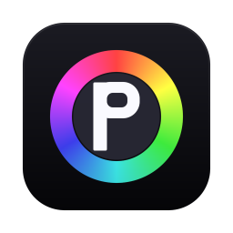
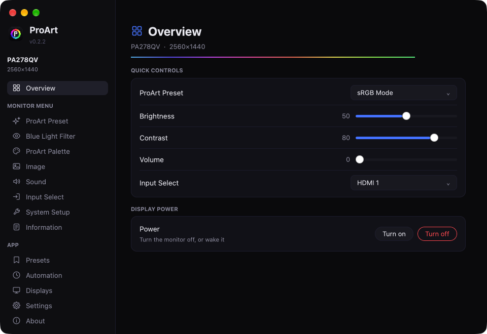

<p align="center">
  
</p>

<h1 align="center">ProArt</h1>

<p align="center">
  
</p>

Control **ASUS ProArt monitors** over DDC/CI from the menu bar (macOS), the system
tray (Windows) or the command line. A Rust rewrite of *ProArt Bar*, with a native
[GPUI](https://www.gpui.rs) interface.

The app mirrors the monitor's own OSD menu:

| Section | Items |
|---|---|
| **ProArt Preset** | Standard, sRGB, Rec. 709, DCI-P3, Scenery, Reading, Darkroom, Rapid Rendering |
| **Blue Light Filter** | Level 0 - 4 |
| **ProArt Palette** | Brightness, Contrast, Saturation, Hue, Color Temp., Gamma, Black Level, Color (R/G/B), Color Reset |
| **Image** | Sharpness, Trace Free, Aspect Control, Input Range, Vivid Pixel, ASCR |
| **Sound** | Volume, Mute, Source |
| **Input Select** | DVI, HDMI, DisplayPort, Mini DisplayPort, AutoDetection |
| **System Setup** | Adaptive-Sync, Power Saving, OSD Setup, QuickFit, Language, DisplayPort Stream, Key Lock, Power Indicator, Information |

A monitor only exposes what its firmware implements: the app lists exactly the
items **your** display answers and hides the rest. Items ASUS never published an
opcode for can be **learned** from the monitor (below).

## Platforms and what is verified

| | Core + CLI | GUI | Status |
|---|---|---|---|
| **macOS** (Apple Silicon; Intel via the IOFBI2C path) | IOAVService DDC/CI | GPUI / Metal | built, run and tested on an Apple M3 Pro with an ASUS PA278QV |
| **Windows** | `dxva2.dll` (same calls as ASUS DisplayWidget Center) | GPUI / DirectX | type-checked for `x86_64-pc-windows-gnu`; **not run** |
| **Linux** | `/dev/i2c-N` via sysfs/DRM | GPUI / Vulkan | type-checked for `x86_64-unknown-linux-gnu`; **not run** |

CI (`.github/workflows/ci.yml`) builds and tests all three on native runners.

## Install

Prebuilt downloads are on the [Releases](https://github.com/uidops/ProArt/releases) page:
a universal macOS `.dmg`, a Windows installer and portable `.zip`, and a Linux
`.tar.gz` (extract it and run `./install.sh --system-i2c`).

To build from source:

```sh
# macOS: builds dist/ProArt.app and dist/ProArt-<version>-macOS.dmg
packaging/macos/build.sh

# Windows (Rust MSVC + Inno Setup 6)
powershell -ExecutionPolicy Bypass -File packaging\windows\build.ps1

# Linux (needs GPUI's system libraries, see ci.yml) + i2c permissions
packaging/linux/install.sh --system-i2c
```

The macOS app is ad-hoc signed. If Gatekeeper complains:
`xattr -dr com.apple.quarantine /Applications/ProArt.app`.

## Use

```
proart-app [--menubar] [--no-tray] [--panel] [--page NAME]  # the GUI (ProArt.app / ProArt.exe once packaged)
proart list | status | features | info                      # inspect
proart get brightness
proart set brightness 60 [--all] [--display 2]
proart set preset "sRGB Mode"
proart set input "HDMI 2" --yes
proart learn preset [--names a,b] [--forget] [--skip]
proart power on|off [--all]        proart mute
proart preset list | save NAME | apply NAME | delete NAME
proart config [--path|--reset]
```

`proart set` waits for the monitor to settle, reads the value back and tells you
when a control was **ignored** - ASUS monitors lock some controls in some
picture modes (a PA278QV in sRGB mode ignores colour-temperature writes).

### Learning ASUS-specific items

ASUS publishes no opcode table. Where ASUS's own tooling documents an opcode and
its values (Gamma, Trace Free, Input Range, ASCR, ...) they are built
in and used only if the monitor answers them. For the rest (e.g. ProArt Preset and
Blue Light Filter on PA278QV-class monitors) ProArt can **learn** them: *Learn...* in the app (or
`proart learn <feature>`) asks you to pick each value in the monitor's own menu,
scans the monitor's registers after each step and keeps the register that tracks
the change. Nothing is written to an opcode that is neither documented nor
learned. See [docs/PROTOCOL.md](docs/PROTOCOL.md).

If you used the Python *ProArt Bar*, its learned mappings and presets are
imported on first run.

### On this Mac (software picture)

Some things a monitor cannot do over DDC/CI the Mac can do through the display's
colour tables, on any monitor, while ProArt runs (macOS restores the picture
when it quits; they do not show in screenshots):

* **Software Blue Light** (Level 0 - 4) and a **Warmth** slider (6500 K - 2700 K),
  on the Blue Light Filter page and in the menu-bar panel;
* **Extra dimming** below the monitor's minimum brightness and a **Gamma** curve
  (1.8 - 2.6), on the ProArt Palette page.

Presets save and restore these with the monitor's own settings. Colour tables
are per channel, so saturation, hue or greyscale cannot be done this way.

### Automation

The Automation page (macOS):

* **Blue light schedule**: warm every monitor between two times, fading in and out;
  a warmer manual setting still wins.
* **Presets at set times**: apply a preset every day at a time; after sleep only
  the latest missed one is applied.
* **Presets per app**: apply a preset while an app is in front (e.g. sRGB for
  Lightroom) and restore the previous settings when you switch away. Input
  Select is never restored behind your back.
* **Keyboard**: the Mac's brightness keys control the monitor under the pointer,
  volume and mute keys control its speakers while sound plays through HDMI or
  DisplayPort, with an on-screen indicator. Needs Privacy & Security >
  Accessibility; the ad-hoc signature changes with every build, so after an
  update remove ProArt from that list and add it again.
* **Ambient light**: monitor brightness from the Mac's light sensor (or from the
  built-in display's brightness), between a darkest and a brightest level; your
  own changes stay as an offset. Not available with the lid closed.
* **Sleep and wake**: monitors go to standby when the Mac sleeps or locks and
  come back when it wakes.

## Layout

```
crates/proart-core   DDC/CI framing, backends (macos/windows/linux/fake), feature
                     registry, learning, settings, display manager
crates/proart-cli    the `proart` command
crates/proart-app    the GPUI app: window, menu-bar panel, tray, widgets
tools/make-icons     renders the app icon set (signed-distance rasteriser)
packaging/           macOS .app/.dmg, Windows installer, Linux install + udev
docs/PROTOCOL.md     what was verified on hardware, and where the opcodes come from
```

## Develop

```sh
cargo test --workspace          # core logic + GPUI interaction tests (no monitor needed)
cargo run -p proart-app -- --page palette   # binary: proart-app
cargo run -p make-icons -- assets/icons
```

`.cargo/config.toml` pins `CFLAGS`/`CXXFLAGS` for this workspace: a global
`-flto=thin` makes C dependencies emit LLVM bitcode the macOS linker cannot read.

MIT licensed. Not affiliated with ASUS; the icon is original artwork.
